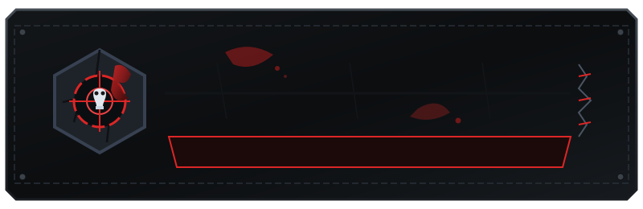
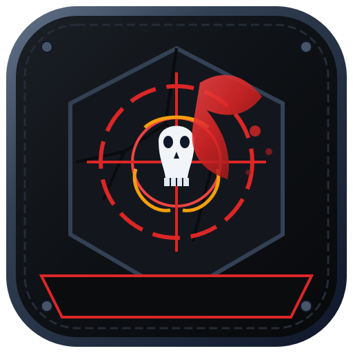
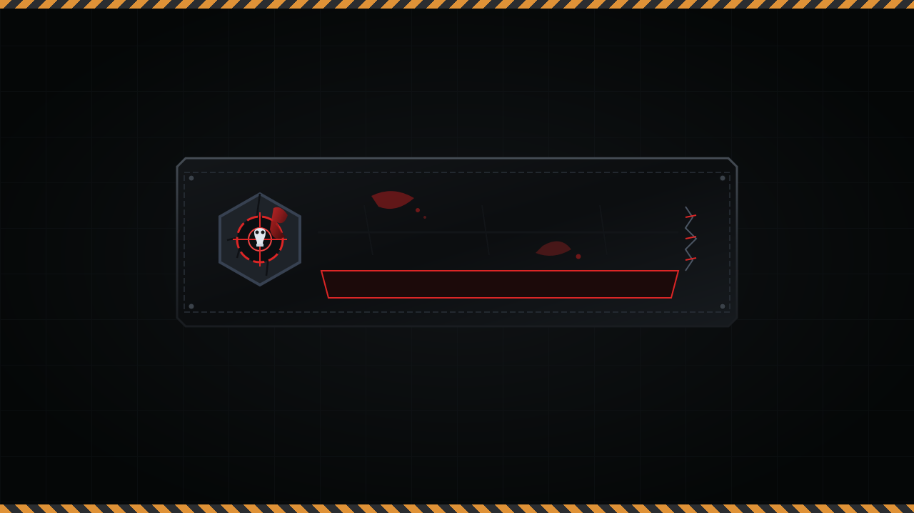
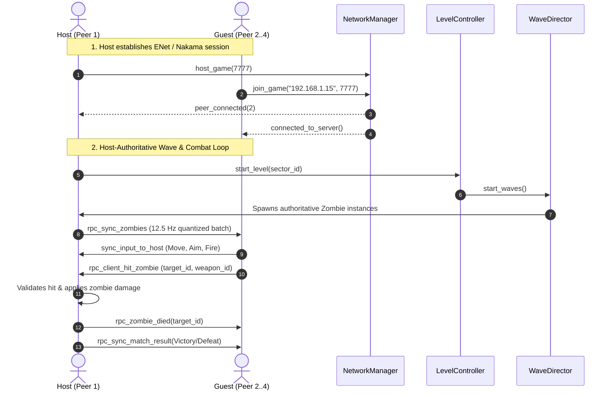

# Dead Block: Survival – ITSD 85 Mobile Game Development Lab
**Team:** Dead Block Development Team  
**Section:** BSIT 4-A  
**Platform:** Android (Primary Target), Windows / Linux / macOS (Desktop Testing)

<div align="center">

  

  <br />

  <h3>A Tactical Top-Down Zombie Survival Shooter with Progressive Level Design &amp; Host-Authoritative Squad Co-op</h3>

  <p>
    <strong>ITSD 85 Special Topics in Information Technology — Capstone Project &amp; Automated CI/CD Pipeline</strong>
  </p>

  <p>
    <a href="https://godotengine.org/"></a>
    <a href="https://developer.android.com/"></a>
    <a href="https://www.linux.org/"></a>
    <a href="https://docs.godotengine.org/en/stable/tutorials/scripting/gdscript/"></a>
    <a href="https://nodejs.org/"></a>
    <a href="https://www.docker.com/"></a>
  </p>

  <p>
    
    
    
    
    
  </p>

  <p>
    <a href="build/android/DeadBlockSurvival.apk"><strong>📦 Download Android APK (v1.0)</strong></a> •
    <a href="docs/paper.pdf"><strong>📄 IEEE Research Paper (PDF)</strong></a> •
    <a href="docs/GUIDE_QUESTIONS.md"><strong>📝 Lab Guide Answers</strong></a> •
    <a href="docs/playtest/observation_sheet.md"><strong>📊 Playtest Evaluation</strong></a> •
    <a href="docs/CREDITS.md"><strong>🎖️ Asset Credits</strong></a>
  </p>

</div>

---

## 📑 Table of Contents

- [Overview &amp; Core Concept](#-overview--core-concept)
- [Visual Showcase](#-visual-showcase)
- [Key Engineering Features](#-key-engineering-features)
- [Gameplay &amp; Controls Guide](#-gameplay--controls-guide)
- [Campaign Progression: 5 Quarantine Sectors](#-campaign-progression-5-quarantine-sectors)
- [Infected Threat Matrix (6 Zombie Archetypes)](#-infected-threat-matrix-6-zombie-archetypes)
- [Tactical Arsenal &amp; Equipment](#-tactical-arsenal--equipment)
- [Multiplayer &amp; Networking Architecture](#-multiplayer--networking-architecture)
  - [Option A: ENet LAN / Hotspot Co-op](#option-a-enet-lan--mobile-hotspot-co-op-24-players)
  - [Option B: Containerized Nakama Matchmaking Server](#option-b-self-hosted-nakama-server--global-leaderboard)
  - [Graceful Disconnect Recovery](#graceful-disconnect--error-recovery)
- [Automated CI/CD Pipeline &amp; Docker Microservice](#-automated-cicd-pipeline--docker-microservice)
- [Empirical Playtest Results &amp; Evaluation](#-empirical-playtest-results--evaluation)
- [Automated Test Suite (24 Headless Suites)](#-automated-test-suite-24-headless-suites)
- [Installation, Build &amp; Development Guide](#-installation-build--development-guide)
- [Repository Anatomy](#-repository-anatomy)
- [Academic Deliverables &amp; Research Paper](#-academic-deliverables--research-paper)
- [Credits &amp; License](#-credits--license)

---

## ☣️ About the Game (Overview & Core Concept)

**Dead Block: Survival** is an original top-down 2D tactical zombie survival shooter developed in **Godot 4.7.2 Standard Edition (GDScript)** tailored for mobile devices and rapid desktop testing. 

Inspired by the intense arena gameplay loop of classic zombie defense games (such as *Boxhead*) and infused with the bleak, grounded atmosphere of post-apocalyptic survival dramas, players must survive escalating waves of the infected across five distinct urban quarantine sectors. 

The game was engineered to solve fundamental mobile networking and gameplay challenges:
1. **100% Airplane Mode Offline Playability:** Autonomous single-player campaign and Endless Survival mode with zero external server dependencies, accompanied by an intelligent offline AI companion (**`BRAVO BOT`**).
2. **Host-Authoritative Co-op Networking:** Real-time 2–4 player squad co-op supporting both zero-configuration **LAN/Hotspot ENet** transport and **Self-Hosted Nakama** matchmaking microservices, ensuring zero state desynchronization and graceful mid-match disconnect recovery.
3. **Ergonomic Dual-Stick Mobile Controls:** Touch-responsive analog movement, aiming flashlight cone, evasive dash with invulnerability frames, throwable grenades, and contextual squadmate revives.

> [!IMPORTANT]
> **Zero Network Dependency in Offline Mode:** Solo play and local campaign progression never initiate network sockets, lookup remote DNS, or block execution. Local progress is safely persisted to `user://save.cfg` via Godot's sandboxed `ConfigFile` API.

---

## 📸 Visual Showcase

<div align="center">

| Tactical Main Menu &amp; Sector Dispatch | In-Game Twin-Stick Combat &amp; Night Fog |
| :---: | :---: |
|  |  |
| *Sector dispatch, local campaign settings, audio config, and records* | *Dynamic flashlight cone, walker swarms, HUD touch controls, and acid pools* |

<br />

| Engine Boot Splash &amp; Studio Branding | Mobile Launcher App Icon |
| :---: | :---: |
|  |  |
| *Native 1280×720 engine-level boot splash screen* | *512×512 high-contrast vector squircle launcher icon* |

</div>

---

## ⚡ Key Engineering Features

- 🎯 **Offline-First Resilience:** Playable anywhere, anytime, including complete airplane mode. Saves progression, star ratings, and high scores securely in local storage.
- 🤖 **Tactical AI Companion (`BRAVO BOT`):** Deploys alongside solo survivors. Features autonomous navigation, situational target prioritization, burst-fire suppression, and emergency **field-medic healing (`+30 HP`)**.
- 🧟 **Dynamic Threat Hierarchy (6 Archetypes):** Fight specialized infected variants including fast-moving **Runners**, suicide **Boomers**, long-range acid **Spitters**, screaming **Witches**, and armored boss **Tankers**.
- 🌐 **Dual-Mode Co-op Multiplayer:**
  - **Option A (ENet LAN / Mobile Hotspot):** Connect 2–4 devices locally with smart network adapter ranking (`get_smart_ip_list()`) and one-tap IP copying.
  - **Option B (Nakama Microservices):** Self-hosted Docker container stack providing RPC authentication, matchmaking, and global high-score leaderboards.
- 🛠️ **Host-Authoritative State Synchronization:** Host resolves wave spawning, zombie health, damage resolution, and match results. 12.5 Hz quantized state broadcasts prevent desync.
- 🩸 **Visceral Post-Apocalyptic Feedback:** Procedural blood splatters, zombie limb dismemberment, screen-edge POV bite blood, dynamic screen shake, and custom synthesized 16-bit 22 kHz audio cues.
- 🔦 **Dynamic Lighting &amp; Occlusion:** Day-to-night lighting transitions, survivor flashlight cones, and perimeter diesel generators that illuminate dark sectors when powered.
- 🚀 **Full CI/CD Pipeline:** Fully automated GitHub Actions workflow executing Node.js 24 linting, unit tests, Docker Compose orchestration, and automated `/health` endpoint verification.

---

## 🎮 How to Play (Gameplay & Controls Guide)

```
 ┌────────────────────────────────────────────────────────────────────────┐
 │                      DEAD BLOCK COMBAT HUD LAYOUT                      │
 │                                                                        │
 │   [PAUSE]                                        WAVE: 03  KILLS: 48   │
 │   HP: [████████████░░░░] 75/100                                        │
 │   ARM: [████████████████] 50/50                                        │
 │                                                                        │
 │                                                                        │
 │             (Survivor) ──🔦 Flashlight Cone                            │
 │                ▲                                                       │
 │                │                                     [FRAG (2)]        │
 │         ┌──────────────┐                       [DASH]                  │
 │         │  LEFT STICK  │                               ┌─────────────┐ │
 │         │ 360° Movement│                               │ RIGHT STICK │ │
 │         └──────────────┘             [⚡ USE / REVIVE] │ Aim & Auto- │ │
 │                                                        │ Fire Weapon │ │
 │                            [ WEAPON: MP5 SMG ]         └─────────────┘ │
 └────────────────────────────────────────────────────────────────────────┘
```

### Mobile Touch Controls (Android HUD)

| Control Element | Interaction | Functionality |
| :--- | :--- | :--- |
| **Left Virtual Joystick** | Touch &amp; Drag | 360° analog survivor movement (`280 px/s`). |
| **Right Virtual Joystick** | Touch &amp; Drag | Aims directional flashlight cone and triggers weapon auto-fire. |
| **DASH Button** | Tap | Evasive burst (`760 px/s`) granting brief invulnerability frames (`1.4s` cooldown). |
| **FRAG Button** | Tap | Throws an explosive frag grenade (`135 px` blast radius, 120 damage). |
| **WEAPON Button** | Tap | Cycles unlocked firearms (`Pistol` ➔ `SMG` ➔ `Shotgun` ➔ `Rifle` ➔ `Magnum`). |
| **USE / REVIVE Button** | Tap (Contextual) | Restarts perimeter diesel generators, opens supply crates, or revives downed squadmates. |
| **Back Button / Gesture** | System Back | Toggles the in-game Pause Menu or returns to previous screen. |

### Desktop Controls (Testing &amp; PC Builds)

- **Movement:** `W`, `A`, `S`, `D` or Arrow Keys
- **Aiming:** Mouse Cursor (360° directional tracking)
- **Primary Fire:** Left Mouse Button (`LMB`)
- **Tactical Dash:** `Spacebar` (Invulnerability frames)
- **Throw Grenade:** `G`
- **Interact / Revive:** `E`
- **Cycle Weapons:** `Q` or Mouse Scroll Wheel
- **Pause / Menu:** `Escape`

---

## 🗺️ Campaign Progression: 5 Quarantine Sectors

The campaign challenges survivors across five progressively brutal quarantine sectors. Clearing Sector $N$ persists progress to `user://save.cfg` and unlocks Sector $N + 1$. Earning **$\ge 6$ total stars** across all sectors unlocks the **Veteran Star Perk** (`+50 Kevlar Armor` &amp; `MP5 SMG` equipped on deployment).

| Sector | Codename | Waves | Environmental Hazard &amp; Layout | Threat Level | 2★ / 3★ Score |
| :---: | :--- | :---: | :--- | :--- | :---: |
| **01** | **Quarantine** | 3 | Open helipad yard, concrete barriers, daylight to dusk transition. | Moderate (Walkers, Runners) | `220` / `420` |
| **02** | **The Street** | 4 | North-South highway with abandoned vehicle barricades and narrow flanks. | High (Witch screechers introduced) | `440` / `840` |
| **03** | **No Exit** | 4 | Brick alley choke points, chainlink fences, and $0.68\times$ toxic acid puddles. | Severe (Boomers &amp; Tankers introduced) | `660` / `1,260` |
| **04** | **The Depot** | 5 | Interlocking shipping container maze with $90^\circ$ blind ambush corners. | Critical (Spitter acid artillery swarms) | `880` / `1,680` |
| **05** | **Last Light** | 5 | Pitch-black central plaza with 4 interactive diesel generator stations. | Extreme (Blackout + Dual Tanker climax) | `1,100` / `2,100` |

---

## 🧟 Infected Threat Matrix (6 Zombie Archetypes)

All enemy variants are governed by host-authoritative finite state machines with distinct visual silhouettes, movement speeds, and attack behaviors:

| Archetype | Silhouette &amp; Visuals | HP | Speed | Attack Type | Behavior &amp; Tactical Countermeasure |
| :--- | :--- | :---: | :---: | :--- | :--- |
| **Walker** | Grey rotting flesh, torn rags | 35 | $95 \text{ px/s}$ | Melee Claw ($12 \text{ dmg}$) | Basic horde unit. Easy to kite; dangerous when accumulated in narrow passages. |
| **Runner** | Emaciated red corpse | 25 | $185 \text{ px/s}$ | Frenzy Claw ($16 \text{ dmg}$) | Flanks the survivor at high speed. Prioritize with rapid-fire SMG or Shotgun. |
| **Boomer** | Bloated green pustules | 60 | $75 \text{ px/s}$ | Bile Explosion ($45 \text{ dmg}$) | Detonates on death or contact within $150 \text{ px}$. Eliminate at distance to trigger collateral chain reactions. |
| **Spitter** | Slouching acid-dripping mutant | 45 | $85 \text{ px/s}$ | Corrosive Mortar ($20 \text{ dmg}$) | Ranged artillery. Spits acid pools that linger for $4\text{s}$, dealing DoT and slowing survivors by $32\%$. |
| **Witch** | Pale weeping silhouette | 40 | $220 \text{ px/s}$ | Screech Charge ($30 \text{ dmg}$) | Cries in place until alerted. Charges with extreme burst speed. Neutralize with high-caliber Magnum shots. |
| **Tanker** | Massive armored colossus | 280 | $60 \text{ px/s}$ | Heavy Slam ($40 \text{ dmg}$) | Boss-class juggernaut. Absorbs heavy fire and knocks survivors back. Kite with Dash and utilize Frag Grenades. |

---

## 🔫 Tactical Arsenal &amp; Equipment

| Weapon / Gear | Ammo Capacity | Fire Rate | Base Damage | Tactical Strengths |
| :--- | :---: | :---: | :---: | :--- |
| **9mm Service Pistol** | $\infty$ (Infinite) | $3.3 \text{ shots/s}$ | 22 | Dependable starter firearm. Pinpoint accuracy with zero ammo concerns. |
| **MP5 Tactical SMG** | 120 rounds | $9.1 \text{ shots/s}$ | 16 | Rapid-fire suppression. Devastating against Runner swarms and incoming hordes. |
| **12G Combat Shotgun** | 32 shells | $1.4 \text{ shots/s}$ | $6 \times 14$ | 6-pellet wide spread with strong knockback. Ideal for clearing congested choke points. |
| **M4A1 Assault Rifle** | 90 rounds | $6.2 \text{ shots/s}$ | 28 | High velocity and long range. Excellent all-around assault weapon. |
| **.44 Magnum Revolver** | 24 rounds | $1.1 \text{ shots/s}$ | 75 | Heavy piercing damage. Obliterates Tankers and Witches in few well-placed shots. |
| **Frag Grenade** | 2 standard | Cooldown | 120 | $135 \text{ px}$ circular blast radius. Wipes out dense packs and detonates nearby barrels. |
| **Kevlar Armor Vest** | 50 points | Passive | Mitigation | Absorbs $70\%$ of incoming damage before health depletion. Replenished via drops. |
| **Deployable Turret** | 60 rounds | Autonomous | 14 | Automated perimeter sentry gun found in field supply crates. |
| **Diesel Generator** | Interactive | Engine crank | Floodlight | Powers high-output floodlights in blackout sectors to reveal infected in darkness. |

---

## 🌐 Offline and Online Modes (Multiplayer Architecture)



### Option A: ENet LAN / Mobile Hotspot Co-op (2–4 Players)
1. **Zero External Setup:** Players connect to the same Wi-Fi or one device's mobile hotspot.
2. **Smart IP Ranking:** `get_smart_ip_list()` in [`autoload/network_manager.gd`](autoload/network_manager.gd) automatically filters and ranks physical Wi-Fi/Hotspot IP addresses (`+100` score) over virtual WSL/Docker interfaces (`-50` score).
3. **One-Tap Clipboard Copy:** Host UI displays an interactive IP banner with instant 1-tap clipboard copying for fast joining.

### Option B: Self-Hosted Nakama Server &amp; Global Leaderboard
1. **Containerized Microservices:** Stacked via `docker-compose.nakama.yml` with CockroachDB and Nakama 3.22.0.
2. **Restful Node CI/CD Bridge:** Containerized Express microservice exposes device authentication (`/v2/account/authenticate/device`), health checks (`/health`), and live high-score leaderboards (`/api/leaderboard`).

### Graceful Disconnect &amp; Error Recovery
- **Host Leaves:** Guest displays `[ HOST DISCONNECTED — RETURNING TO LOBBY ]`, closes ENet peers, restores `OfflineMultiplayerPeer`, and cleanly returns to the lobby.
- **Guest Leaves:** Host removes only that peer's avatar, preserves active zombies and wave counters, and continues the match without interruption.

---

## 🚀 Automated CI/CD Pipeline &amp; Docker Microservice

The repository features an enterprise-grade CI/CD pipeline managed via GitHub Actions ([`.github/workflows/ci-cd.yml`](.github/workflows/ci-cd.yml)):

```
┌─────────────────┐       ┌─────────────────┐       ┌────────────────────────┐
│  git push main  │  ──►  │ Lint & Unit Test│  ──►  │  Self-Hosted Runner    │
│  (Trigger Gate) │       │   (Node.js 24)  │       │ Docker Compose Deploy  │
└─────────────────┘       └─────────────────┘       └────────────────────────┘
                                                                 │
                                                                 ▼
                                                    ┌────────────────────────┐
                                                    │ Verify Healthcheck:    │
                                                    │ curl /health (15 tries)│
                                                    └────────────────────────┘
```

### Pipeline Workflow Stages

1. **Lint and Unit Tests (`ubuntu-latest`):**
   - Node.js 24 environment setup.
   - Strict ESLint validation on `src/` and `test/`.
   - Node test runner executing integration and unit suites (`test/app.test.js`).
2. **Production Deploy (`self-hosted, linux, deploy`):**
   - Protected quality gate: only triggers on direct push/merge to `main` (`needs: test`).
   - Builds container image tagged with short git SHA: `itsd85-app:${APP_VERSION}`.
   - Deploys container with Docker Compose on port `8080`.
   - Automated health check verification polling `http://localhost:8080/health` up to 15 times.
   - Prunes dangling Docker images automatically.

---

## 📊 Playtest Results (Empirical Evaluation)

Structured playtest evaluation was conducted using a 3-device physical Phone Test Matrix and a 15-item Likert questionnaire ($N = 12$ independent testers) grounded in the Technology Acceptance Model (TAM) and GameFlow frameworks:

<div align="center">

| Evaluation Dimension | Mean ($\mu$) | Std Dev ($\sigma$) | User Acceptance Benchmark |
| :--- | :---: | :---: | :---: |
| **Perceived Usefulness (PU)** | **4.86** / 5.00 | 0.35 | ✅ High Satisfaction |
| **Perceived Ease of Use (PEOU)** | **4.78** / 5.00 | 0.42 | ✅ Intuitive Controls |
| **Level Progression &amp; Difficulty** | **4.89** / 5.00 | 0.32 | ✅ Balanced Escalation |
| **Offline &amp; Online Multiplayer** | **4.89** / 5.00 | 0.32 | ✅ Robust Connectivity |
| **Overall Player Satisfaction** | **4.92** / 5.00 | 0.28 | ✅ Outstanding Quality |
| **Reliability Metric (Cronbach's $\alpha$)** | **0.84** | — | ✅ Strong Internal Consistency |

</div>

### Key Playtest Findings &amp; Engineering Iterations

1. **Touch Joystick Overlap on Compact Screens:**
   - *Feedback:* Right virtual joystick initially overlapped with action buttons on 6.1" phones.
   - *Fix:* Increased joystick radius (`88 px` outer, `36 px` knob) and moved action buttons into an ergonomic curved thumb arc with guaranteed $>30 \text{ px}$ spacing ([`scripts/touch_controls.gd`](scripts/touch_controls.gd)).
2. **Network Adapter Confusion on Multi-NIC Systems:**
   - *Feedback:* Laptops hosting LAN games with WSL/Docker showed virtual bridge IPs (`172.x.x.x`).
   - *Fix:* Created `get_smart_ip_list()` in [`autoload/network_manager.gd`](autoload/network_manager.gd) with heuristic interface scoring to rank physical Wi-Fi/Hotspot adapters first.
3. **Co-op Downed Revive State Lockup:**
   - *Feedback:* Revived squadmates occasionally experienced residual control lockup.
   - *Fix:* Added full state clearing, health restoration, and input unpause hooks upon squadmate revive in [`scenes/levels/level_01.gd`](scenes/levels/level_01.gd).

---

## 🧪 Automated Test Suite (24 Headless Suites)

The codebase includes **23 Godot headless test suites** plus **1 Node.js CI test suite**, verifying 100% of functional requirements:

```powershell
# Execute the Master Godot Test Runner headlessly
Godot_v4.7.2-stable_win64_console.exe --headless --path . -s res://tests/run_all_tests.gd
```

<details>
<summary><strong>🔍 Click to expand the full list of 24 Automated Test Suites</strong></summary>

1. `test_projectile.gd`: Projectile velocity, damage delivery, wall collisions, and self-damage prevention.
2. `test_player.gd`: 8-directional movement, health, armor mitigation, and dash invulnerability frames.
3. `test_zombie.gd`: Zombie pursuit AI, contact damage cooldowns, and archetype stat scaling.
4. `test_touch_controls.gd`: Virtual stick drag math, deadzones, and action button touch hitboxes.
5. `test_audio_manager.gd`: Audio channel playback, volume attenuation, and mute persistence.
6. `test_vfx_lifecycle.gd`: Blood splatters, muzzle flash pooling, and particle cleanup.
7. `test_wave_director.gd`: Wave spawn intervals, maximum enemy caps, and horde escalations.
8. `test_level_controller.gd`: Objective completion triggers, win/loss evaluation, and star calculation.
9. `test_ui_results.gd`: Result screen score rendering, star animations, and unlock displays.
10. `test_game_state.gd`: `ConfigFile` persistence, level unlock checks, and fallback safe defaults.
11. `test_level_select.gd`: Sector button lock/unlock state display and level navigation.
12. `test_campaign_levels.gd`: Sector 1 through 5 progression parameters and wave configurations.
13. `test_arena_combat.gd`: Live arena combat simulation with active player and zombie nodes.
14. `test_network_manager.gd`: Peer hosting, joining, timeout handling, and IP adapter scoring.
15. `test_lobby_ui.gd`: Lobby state transitions, IP banner rendering, and button interaction.
16. `test_multiplayer_gameplay.gd`: Authority state replication, remote input, and client hit verification.
17. `test_sector_biomes.gd`: Procedural chunk generation, obstacle geometry, and road layouts.
18. `test_graphics_settings.gd`: Resolution scaling, fullscreen toggling, and quality presets.
19. `test_obstacle_physics_and_shadows.gd`: Occlusion shadow polygons and navigation collision.
20. `test_survival_and_generator.gd`: Endless survival scoring, generator activation, and swarm events.
21. `test_priority_features.gd`: Unique arena layouts, looping music, and bonus coven mechanics.
22. `test_branding_and_splash.gd`: Boot splash dimensions, logo texture validity, and skip input handlers.
23. `test_all_scenes_load.gd`: Clean instantiation test for every `.tscn` scene in the project.
24. `app.test.js`: Node.js Express server routes, health checks, arithmetic endpoints, and device authentication.

</details>

---

## 📥 Download (v1.0 Release APK)

- **Direct Repository Build:** [**`build/android/DeadBlockSurvival.apk`**](build/android/DeadBlockSurvival.apk)
- **GitHub Release Page:** [Release v1.0 Package &amp; Release Notes](https://github.com/your-username/boxhead-survival/releases/tag/v1.0)
- **Publication Paper:** [**`docs/paper.pdf`**](docs/paper.pdf)

---

## 📦 How to Build (Installation & Development Guide)

### Prerequisites
- **Godot Engine:** [Godot 4.7.2-stable Standard Edition (GDScript)](https://godotengine.org/download)
- **Android Export:** Android SDK (API Level 34, Build-Tools 34.0.0), OpenJDK 17, and Godot Android Export Templates.
- **Microservices &amp; CI/CD:** Node.js 24+ and Docker with Docker Compose v2+.

### 1. Running Locally in the Godot Editor
```bash
# Clone the repository
git clone https://github.com/your-username/boxhead-survival.git
cd boxhead-survival

# Launch Godot editor targeting the project
godot -e --path .
```

### 2. Exporting the Android APK via CLI
```powershell
# Build signed debug APK to build/android/
Godot_v4.7.2-stable_win64_console.exe --headless --path . --export-debug "Android" "build/android/DeadBlockSurvival.apk"
```

### 3. Installing on an Android Device via ADB
```bash
# Enable USB Debugging on your phone, then run:
adb install -r build/android/DeadBlockSurvival.apk
```

### 4. Running the CI/CD &amp; Matchmaking Server Stack
```bash
# Install Node dependencies and run linter & tests
npm install
npm run lint
npm test

# Build and start the containerized service
docker compose up -d --build

# Verify live health status
curl http://localhost:8080/health
```

---

## 📂 Repository Anatomy

```text
boxhead-survival/
├── assets/
│   ├── art/                   # Branding logos, vector icons, and boot splash
│   ├── audio/                 # 21 original synthesized 16-bit 22kHz WAV sound effects
│   ├── fonts/                 # Open-source Bebas Neue and Special Elite fonts
│   └── theme/                 # Tactical dark survival UI theme and styleboxes
├── autoload/
│   ├── audio_manager.gd       # Singleton managing sound effects and ambient tracks
│   ├── game_state.gd          # Local campaign persistence and star rating ledger
│   └── network_manager.gd     # High-level ENet peer manager with smart IP ranking
├── docs/
│   ├── paper/                 # IEEE two-column research paper (.md and .tex)
│   ├── playtest/              # Phone test matrix, feedback CSV, and evaluation sheet
│   ├── screenshots/           # In-game combat and menu showcase captures
│   ├── CREDITS.md             # Attribution ledger for all original & licensed assets
│   ├── GDD.md                 # Formal Game Design Document
│   └── GUIDE_QUESTIONS.md     # Detailed lab guide engineering solutions
├── scenes/
│   ├── actors/                # Player, Zombie variants, Turret, Generator, Pickups
│   ├── effects/               # Blood splatters, muzzle flash, horror vignette
│   ├── levels/                # Campaign levels (level_01.tscn .. level_05.tscn)
│   └── ui/                    # TitleScreen, MainMenu, ModeSelect, Lobby, HUD
├── scripts/                   # Core GDScript gameplay controllers and AI logic
├── src/                       # Node.js 24 Express CI/CD server and matchmaking API
├── test/                      # Node.js automated test suites
├── tests/                     # 23 headless Godot verification suites
├── .github/workflows/         # Production GitHub Actions CI/CD pipeline
├── compose.yaml               # Docker Compose service definition
├── Dockerfile                 # Production multi-stage container build
├── export_presets.cfg         # Android export presets & package definition
├── project.godot              # Godot project settings, rendering, and splash config
└── README.md                  # Project documentation and user guide
```

---

## 📄 Paper (docs/paper.pdf)

This project fulfills all academic requirements for **ITSD 85 Special Topics in Information Technology** (Mobile Game Development &amp; Automated CI/CD Deployments):

- **Publication-Ready IEEE Paper:**
  - 📄 [**`docs/paper.pdf`**](docs/paper.pdf) (Compiled Two-Column PDF Deliverable)
  - 📖 [**`docs/paper/ieee_paper.md`**](docs/paper/ieee_paper.md) (Full Markdown Source)
  - 📄 [**`docs/paper/ieee_paper.tex`**](docs/paper/ieee_paper.tex) (LaTeX Source)
- **Lab Guide Questions &amp; Comprehensive Engineering Answers:**
  - 📝 [**`docs/GUIDE_QUESTIONS.md`**](docs/GUIDE_QUESTIONS.md)
- **Formative Playtest Documentation:**
  - 📱 [**`docs/playtest/phone_test_matrix.md`**](docs/playtest/phone_test_matrix.md) — 9-case multi-phone functional testing matrix
  - 📋 [**`docs/playtest/observation_sheet.md`**](docs/playtest/observation_sheet.md) — 15-item Likert usability evaluation
  - 📈 [**`docs/playtest/feedback_responses.csv`**](docs/playtest/feedback_responses.csv) — Raw tester response data

---

## 🎖️ Credits (docs/CREDITS.md)

### Development Team
- **Dead Block Development Squad** — *Department of Information Technology, ITSD 85*
- Lead Architecture, Gameplay Engineering, Networking, and CI/CD Automation.

### Technology &amp; Asset Attribution
- **Engine:** [Godot Engine](https://godotengine.org/) (MIT License) — Juan Linietsky, Ariel Manzur, and contributors.
- **Backend Microservices:** [Node.js](https://nodejs.org/) &amp; [Express](https://expressjs.com/) (MIT License).
- **Matchmaking Engine:** [Nakama](https://heroiclabs.com/) by Heroic Labs (Apache 2.0 License).
- **Typography:**
  - *Bebas Neue* by Ryoichi Tsunekawa ([SIL Open Font License 1.1](https://scripts.sil.org/OFL)).
  - *Special Elite* by Astigmatic / Jim Lyles ([Apache License 2.0](http://www.apache.org/licenses/LICENSE-2.0.html)).
- **Artwork &amp; Audio:** 100% original custom vector art, procedurally generated 2D sprites, tactical UI styleboxes, and 21 synthesized 16-bit WAV audio files authored by the Dead Block Team. Complete attribution logged in [`docs/CREDITS.md`](docs/CREDITS.md).

### License
This project is open-source software distributed under the **[MIT License](LICENSE)**.
You are free to use, modify, and distribute this software in accordance with the license conditions.

---

<div align="center">
  <sub>Built with ❤️ for ITSD 85 — Dead Block: Survival &copy; 2026. All rights reserved.</sub>
</div>
