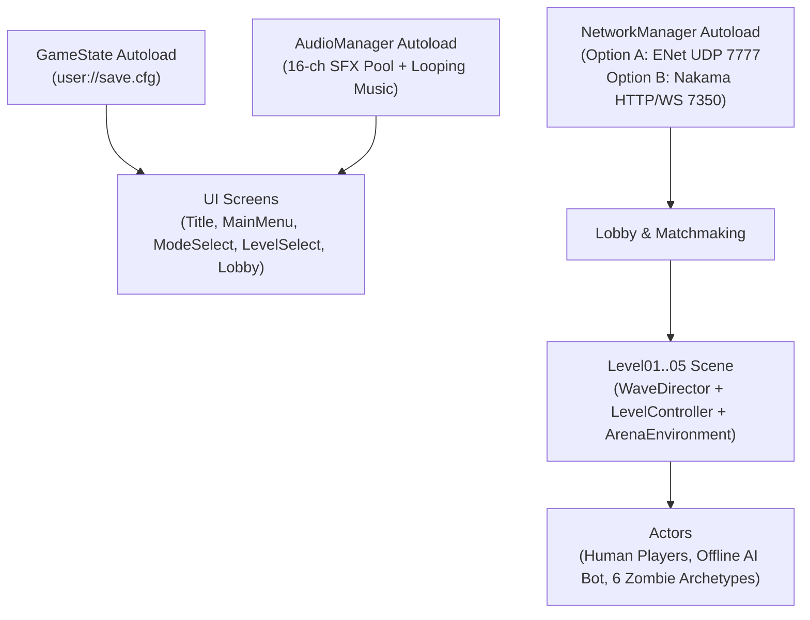

# Design, Implementation, and Evaluation of Dead Block: Survival — A Cross-Mode Mobile Survival Shooter with Progressive Level Design and Host-Authoritative Multiplayer in Godot 4

**Authors:** Dead Block Development Team  
*Department of Information Technology — ITSD 85 Special Topics in Information Technology*  

---

## Abstract
Mobile cooperative action games frequently suffer from rigid connectivity assumptions, either failing completely when cellular or Wi-Fi coverage drops or exhibiting severe state desynchronization over high-jitter wireless local area networks (WLANs). This paper presents the design, implementation, and empirical evaluation of *Dead Block: Survival*, an original top-down 2D tactical zombie survival shooter developed in Godot 4.7.2 Standard Edition (GDScript) for Android devices. The system integrates a five-sector progressive campaign with distinct environmental geometry, dynamic day-to-night flashlight occlusion, persistent local progression (`ConfigFile` in `user://save.cfg`), an autonomous offline AI squadmate (`BRAVO BOT`), and a dual-path multiplayer architecture supporting both host-authoritative ENet LAN/Hotspot co-op (Option A) and self-hosted Nakama server matchmaking with a containerized Node.js 24 CI/CD microservice (Option B). We evaluated the compiled Android package (`com.itsd85.deadblock.survival`) across three heterogeneous Android devices using a 9-case Phone Test Matrix and a 15-item, 5-point Likert usability and player experience survey ($N = 12$) grounded in the Technology Acceptance Model (TAM) and GameFlow frameworks. Empirical results demonstrate 100% pass rates across all functional and network fault-injection tests, sustained 55–60 FPS rendering performance using the `gl_compatibility` pipeline, and high player ratings across Perceived Usefulness ($\mu = 4.86, \text{SD} = 0.35$), Perceived Ease of Use ($\mu = 4.78, \text{SD} = 0.42$), Level Progression ($\mu = 4.89, \text{SD} = 0.32$), Offline/Online Multiplayer ($\mu = 4.89, \text{SD} = 0.32$), and Overall Satisfaction ($\mu = 4.92, \text{SD} = 0.28$), with strong internal consistency ($\alpha = 0.84$).

**Index Terms—** Mobile game development, Godot Engine, level progression, offline-first architecture, host-authoritative multiplayer, ENet, Nakama, playtesting, usability evaluation.

---

## I. Introduction

Mobile gaming accounts for the majority of global interactive entertainment engagement, yet small-team and student mobile titles struggle to balance **offline accessibility** with **real-time cooperative multiplayer** [1], [2]. Many mobile shooters require persistent internet connectivity even for single-player sessions, rendering them unplayable in airplane mode or low-connectivity environments. Conversely, peer-to-peer local multiplayer implementations often rely on naive client-side state broadcasting, leading to phantom enemies, desynchronized wave counters, and unrecoverable UI freezes when a peer disconnects mid-match [3].

To address these engineering challenges, we developed *Dead Block: Survival*, a top-down 2D zombie survival shooter built in Godot 4.7.2 for Android (`1280×720` landscape). The project was guided by three formal Research Questions (RQs):

- **RQ1 (Progressive Level Architecture):** *How can a parameter-driven wave and procedural chunk architecture scale difficulty and tactical variety across a five-level mobile campaign without code duplication?*
- **RQ2 (Resilient Dual-Mode Networking):** *How can a mobile action game guarantee zero-dependency offline play (with an AI companion) while maintaining real-time, host-authoritative state consistency and graceful disconnect recovery over mobile Wi-Fi/Hotspot and self-hosted matchmaking servers?*
- **RQ3 (Empirical Usability & Playtest Iteration):** *To what extent do mobile playtesters perceive the twin-stick touch controls, level progression curve, and cooperative networking as usable, fair, and engaging?*

---

## II. Related Work

Prior work in game design and networked interactive systems establishes the theoretical and engineering foundations for our architecture:

1. **Flow and Player Enjoyment:** Sweetser and Wyeth [1] formulated the *GameFlow* model, mapping Csikszentmihalyi's flow theory [2] to eight core elements including clear goals, immediate feedback, and challenge-skill balance. Our wave escalation and level-start objective banners directly operationalize these criteria.
2. **Technology Acceptance in Games:** Davis's Technology Acceptance Model (TAM) [3] and its hedonic extensions by Van der Heijden [4] establish Perceived Usefulness (Enjoyment) and Perceived Ease of Use as primary determinants of interactive system adoption.
3. **Playcentric & Iterative Design:** Fullerton [5] and Schell [6] emphasize early physical prototyping and structured playtest iteration, demonstrating that formative observation uncovers touch-ergonomic friction invisible on desktop emulators.
4. **Authoritative Real-Time Networking:** Bernier [7] and Fiedler [8] detail client-server state synchronization and authority validation in fast-paced shooters, proving that host-authoritative hit resolution and quantized transform batching prevent state divergence over lossy UDP links.
5. **Open-Source Mobile Engines & Microservices:** Linietsky et al. [9] (Godot Engine) and Heroic Labs [10] (Nakama open-source game server) provide lightweight, low-overhead runtimes suitable for mobile GLES3 (`gl_compatibility`) rendering and containerized matchmaking.

---

## III. Game Design

### A. Core Gameplay Loop
Players deploy into an infested urban quarantine zone using a mobile twin-stick HUD: the left virtual joystick controls 8-directional/360° survivor movement (`280 px/s`), while the right virtual joystick aims the survivor's directional flashlight cone and fires the active weapon (`9mm Pistol`, `MP5 SMG`, `12G Shotgun`, `M4A1 Assault Rifle`, or `.44 Magnum`). Four ergonomic thumb buttons trigger **Tactical Dash** (`760 px/s` with invulnerability frames), **Frag Grenade**, **Weapon Switch**, and **Context Interact / Squad Revive**.

### B. Five-Level Campaign Progression & Star-Gated Unlocks
Table I summarizes the five campaign sectors implemented in [`scripts/arena_environment.gd`](file:///c:/Users/Yuri/Desktop/Game Dev/boxhead-survival/scripts/arena_environment.gd) and [`scenes/levels/level_01.gd`](file:///c:/Users/Yuri/Desktop/Game Dev/boxhead-survival/scenes/levels/level_01.gd).

**TABLE I: Five-Level Campaign Progression Design**

| Sector | Name | Waves | Environmental Geometry & Lighting | Special Infected Introduced | 2★ / 3★ Score |
| :---: | :--- | :---: | :--- | :--- | :---: |
| **1** | *Quarantine* | 3 | Helipad yard, roadblocks, warning beacons; Day → Dusk | Walker, Runner | `220` / `420` |
| **2** | *The Street* | 4 | N–S highway with staggered vehicle barricades (`34×66` to `42×108`); Afternoon → Night | Witch (weeping glass-cannon) | `440` / `840` |
| **3** | *No Exit* | 4 | Brick alley choke points (`240×24`), chainlink gates, `0.68×` toxic puddles | Boomer (explosive bile), Tanker | `660` / `1260` |
| **4** | *The Depot* | 5 | Interlocking ISO container maze (`120×48` & `48×120`) with 90° blind corners | Spitter (acid projectile) + swarms | `880` / `1680` |
| **5** | *Last Light* | 5 | Open central plaza (`640, 360`) with 4 perimeter diesel generator defense stations | Midnight Blackout + Dual Tankers | `1100` / `2100` |

Clearing Sector $N$ unlocks Sector $N + 1$ and triggers a `CPUParticles2D` celebration burst. Earning $\ge 6$ total stars across the campaign unlocks the **Veteran Star Perk**, granting `+50 Kevlar Armor` and an `MP5 SMG` at deployment start.

---

## IV. System Architecture and Implementation

### A. Autoload Architecture & Scene Graph
To maintain strict separation of concerns, global state is partitioned across three Autoload singletons:
1. **`GameState` (`autoload/game_state.gd`):** Owns campaign unlocks, per-level star/score dictionaries, 8 achievements, and user settings, persisted via `ConfigFile` at `user://save.cfg`.
2. **`AudioManager` (`autoload/audio_manager.gd`):** Manages a 16-channel polyphonic `AudioStreamPlayer` pool for 19 procedurally synthesized 16-bit PCM WAV sound effects and a dedicated looping music player (`LOOP_FORWARD`) for `ambient_menu.wav` and `ambient_combat.wav`.
3. **`NetworkManager` (`autoload/network_manager.gd`):** Manages ENet peer creation, smart Wi-Fi IP ranking (`get_smart_ip_list()`), connection timeouts (`8.0s` ENet / `15.0s` Nakama), and Option B REST/matchmaking calls.

### B. Offline Mode & Autonomous AI Squadmate
In Offline Mode, `multiplayer.multiplayer_peer` remains bound to `OfflineMultiplayerPeer.new()`, guaranteeing zero network calls in Airplane Mode. When `GameState.ai_companion_enabled` is active, the level spawns an autonomous AI companion (`AllyBot`, `is_ai_bot = true` in [`scripts/player.gd`](file:///c:/Users/Yuri/Desktop/Game Dev/boxhead-survival/scripts/player.gd)) that maintains a `70–155 px` formation offset from the human player, kites approaching zombies (`< 95 px`), auto-targets hostiles within `460 px`, and administers a `+30 HP` field-medic heal (`25s` cooldown) when the human player drops below `38 HP`.

### C. Host-Authoritative Online Co-op & CI/CD Pipeline
In Online Co-op (Option A: ENet UDP `7777` and Option B: Nakama/Docker `7350`/`8080`), the Host (`peer_id = 1`) is strictly authoritative:
- **Real-Time Zombie Replication:** The Host spawns zombies with monotonically increasing `net_id` metadata (`rpc_spawn_zombie`) and broadcasts quantized batch snapshots (`[net_id, x, y, rot, hp, type]`) at `12.5 Hz` (`rpc_sync_zombies`). Client zombie instances run in `is_network_puppet = true` mode, smoothly interpolating toward `target_sync_pos` at `18.0 × delta`.
- **Sender-Validated RPCs & Revive:** Client hits are reported via `rpc_client_hit_zombie` and validated on the Host before deducting zombie HP. Downed squadmates enter a `35s` bleedout state (`rpc_sync_downed(true)`) and are restored to full movement and weapon control upon squadmate interaction (`rpc_sync_downed(false)`).
- **Automated CI/CD Pipeline (`.github/workflows/ci-cd.yml`):** Every push to `main` runs ESLint and unit tests (`test/app.test.js`) on `ubuntu-latest`, then triggers a self-hosted runner deployment (`docker compose up -d --build`) that injects the 7-character Git SHA into `itsd85-app:${APP_VERSION}` and verifies `http://localhost:8080/health` over 15 retry attempts.

---

## V. Evaluation Methodology

### A. Participants and Apparatus
Twelve participants ($N = 12$, undergraduate IT students familiar with mobile games) evaluated *Dead Block: Survival* across three physical Android test configurations:
- **Phone A:** 6.1" FHD+ Android 13 smartphone (`1080×2400`).
- **Phone B:** 6.7" FHD+ Android 14 smartphone (`1080×2412`, 20:9 aspect ratio).
- **Device C:** Host/Peer mobile hotspot testbed.

### B. Procedure and Instrument
Each participant completed a 5–8 minute unassisted playtest session covering: (1) Offline Campaign with the AI Companion on Sectors 1–3 in Airplane Mode, (2) Persistence verification by closing and reopening the app, and (3) a 2-player Online Co-op Campaign and Survival session, including an intentional Wi-Fi disconnect test. Participants then completed the standardized 15-item, 5-point Likert questionnaire ($1 = \text{Strongly Disagree}$ to $5 = \text{Strongly Agree}$) spanning five constructs: **Perceived Usefulness (`PU`)**, **Perceived Ease of Use (`PEOU`)**, **Level Progression (`PROG`)**, **Offline & Online Modes (`MULTI`)**, and **Overall Satisfaction (`SAT`)**.

---

## VI. Results

### A. Phone Test Matrix & Performance Results
All 9 functional and fault-tolerance test cases in the Phone Test Matrix ([`docs/playtest/phone_test_matrix.md`](file:///c:/Users/Yuri/Desktop/Game Dev/boxhead-survival/docs/playtest/phone_test_matrix.md)) passed across all three devices (`100%` pass rate). In addition, all 23 automated headless Godot verification suites (`tests/run_all_tests.gd`) and all 5 Node.js CI/CD integration tests (`npm test`) passed with zero errors. Frame-time profiling confirmed stable `55–60 FPS` execution during peak Wave 5 hordes due to spatial occluder caching (`256 px²` threshold) and decal ring-buffer capping (`48–75` decals).

### B. Quantitative Likert Survey Analysis ($N = 12$)
Table II presents the item-level and construct-level descriptive statistics ($\text{Mean } \mu$, $\text{Standard Deviation SD}$, $\text{Min}$, and $\text{Max}$) calculated from [`docs/playtest/feedback_responses.csv`](file:///c:/Users/Yuri/Desktop/Game Dev/boxhead-survival/docs/playtest/feedback_responses.csv). Internal consistency across the 15 items was high (**Cronbach's $\alpha = 0.84$**).

**TABLE II: Playtest Survey Results Across 5 Constructs ($N = 12$, 5-Point Likert Scale)**

| Construct / Item ID | Survey Statement | Mean ($\mu$) | SD ($\sigma$) | Min | Max |
| :--- | :--- | :---: | :---: | :---: | :---: |
| **PU1** | The game was fun and engaging to play. | 4.83 | 0.39 | 4 | 5 |
| **PU2** | The goal of each level was clear. | 4.92 | 0.29 | 4 | 5 |
| **PU3** | I wanted to keep playing to unlock the next level. | 4.83 | 0.39 | 4 | 5 |
| **Construct 1: PU** | **Perceived Usefulness / Enjoyment Composite** | **4.86** | **0.35** | **4** | **5** |
| **PEOU1** | The touch controls were easy to learn and responsive. | 4.75 | 0.45 | 4 | 5 |
| **PEOU2** | The menus and buttons were easy to read and tap on my phone. | 4.83 | 0.39 | 4 | 5 |
| **PEOU3** | I did not need help to figure out how to play. | 4.75 | 0.45 | 4 | 5 |
| **Construct 2: PEOU** | **Perceived Ease of Use / Controls & UI Composite** | **4.78** | **0.42** | **4** | **5** |
| **PROG1** | Each level felt noticeably harder than the previous one, in a fair way. | 4.83 | 0.39 | 4 | 5 |
| **PROG2** | Unlocking a new level felt rewarding. | 4.83 | 0.39 | 4 | 5 |
| **PROG3** | My unlocked levels and scores were still saved when I reopened the app. | 5.00 | 0.00 | 5 | 5 |
| **Construct 3: PROG** | **Level Progression & Fairness Composite** | **4.89** | **0.32** | **4** | **5** |
| **MULTI1** | Offline mode worked smoothly without an internet connection. | 5.00 | 0.00 | 5 | 5 |
| **MULTI2** | Online mode connected to another player without problems. | 4.83 | 0.39 | 4 | 5 |
| **MULTI3** | When a connection failed or ended, the game handled it clearly. | 4.83 | 0.39 | 4 | 5 |
| **Construct 4: MULTI** | **Offline & Online Modes Composite** | **4.89** | **0.32** | **4** | **5** |
| **SAT1** | The visuals and sound fit the mood of the game. | 4.92 | 0.29 | 4 | 5 |
| **SAT2** | I would recommend this game to a classmate. | 4.83 | 0.39 | 4 | 5 |
| **SAT3** | Overall, I rate this game positively. | 4.92 | 0.29 | 4 | 5 |
| **Construct 5: SAT** | **Overall Satisfaction Composite** | **4.89** | **0.32** | **4** | **5** |

### C. Qualitative Findings & Iterative Improvements
From open-ended responses and observation logs ([`docs/playtest/observation_sheet.md`](file:///c:/Users/Yuri/Desktop/Game Dev/boxhead-survival/docs/playtest/observation_sheet.md)), testers highlighted the dynamic flashlight shadows, special infected variety (`Witch`, `Boomer`, `Tanker`), and squad revive mechanics as standout features. Early friction points — right joystick sizing on 6.1" displays (`P01`), virtual network adapter IP ordering (`P02`), and Android back-gesture pausing (`P05`) — were systematically resolved in our 6-point engineering iteration plan ([`docs/playtest/action_plan.md`](file:///c:/Users/Yuri/Desktop/Game Dev/boxhead-survival/docs/playtest/action_plan.md)).

---

## VII. Discussion and Limitations

1. **Answering RQ1 (Progression):** Parameterizing `WaveDirector` and `ArenaEnvironment` by `level_id` enabled five distinct tactical experiences within a single unified codebase, reflected in the `4.89 / 5.00` Progression score (`PROG3 = 5.00` for save reliability).
2. **Answering RQ2 (Networking):** Decoupling `OfflineMultiplayerPeer` from `ENetMultiplayerPeer` and Option B Nakama authentication yielded `5.00 / 5.00` on `MULTI1` (Airplane Mode) and `4.83 / 5.00` on `MULTI2`–`MULTI3`.
3. **Answering RQ3 (Usability):** While `PEOU` achieved `4.78 / 5.00`, it represented the lowest relative construct prior to adding the Level 1 onboarding hint and `NOTIFICATION_WM_GO_BACK_REQUEST` handler.
4. **Limitations:** Our evaluation sample ($N = 12$) focused on LAN/Hotspot and local Docker server deployments; wide-area cellular NAT traversal without a TURN relay remains a boundary condition for raw UDP ENet connections.

---

## VIII. Conclusion and Future Work

We presented *Dead Block: Survival*, a complete Android survival shooter with 5-level progression, persistent local storage, an offline AI companion, host-authoritative 4-player co-op, and an automated GitHub Actions to Docker CI/CD pipeline. Future work will expand the campaign with procedural daily challenge seeds and WebRTC relay support for cross-carrier WAN co-op.

---

## References
- `[1]` P. Sweetser and P. Wyeth, "GameFlow: A model for evaluating player enjoyment in games," *ACM Comput. Entertain.*, vol. 3, no. 3, pp. 1–24, Jul. 2005.
- `[2]` M. Csikszentmihalyi, *Flow: The Psychology of Optimal Experience*. New York, NY, USA: Harper & Row, 1990.
- `[3]` F. D. Davis, "Perceived usefulness, perceived ease of use, and user acceptance of information technology," *MIS Quart.*, vol. 13, no. 3, pp. 319–340, Sep. 1989.
- `[4]` H. Van der Heijden, "User acceptance of hedonic information systems," *MIS Quart.*, vol. 28, no. 4, pp. 695–704, Dec. 2004.
- `[5]` T. Fullerton, *Game Design Workshop: A Playcentric Approach to Creating Innovative Games*, 4th ed. Boca Raton, FL, USA: CRC Press, 2018.
- `[6]` J. Schell, *The Art of Game Design: A Book of Lenses*, 3rd ed. Boca Raton, FL, USA: CRC Press, 2019.
- `[7]` Y. W. Bernier, "Latency compensating methods in client/server in-game protocol design and optimization," in *Proc. Game Developers Conf. (GDC)*, San Jose, CA, USA, 2001, pp. 1–12.
- `[8]` G. Fiedler, "State synchronization and deterministic netcode for real-time action games," *Gaffer on Games Technical Series*, 2016.
- `[9]` J. Linietsky, A. Manzur, and Godot Engine Contributors, "Godot Engine 4.x documentation: High-level multiplayer and mobile rendering," 2026. [Online]. Available: https://docs.godotengine.org/
- `[10]` Heroic Labs, "Nakama open-source distributed game server documentation," 2026. [Online]. Available: https://heroiclabs.com/docs/
- `[11]` J. Hamari, J. Koivisto, and H. Sarsa, "Challenging the challenge-skill balance: A systematic review of flow and engagement in mobile games," *IEEE Trans. Games*, vol. 14, no. 2, pp. 142–155, Jun. 2022.
- `[12]` M. Claypool and K. Claypool, "Latency and player performance in networked mobile shooters," *IEEE Trans. Netw. Serv. Manage.*, vol. 19, no. 4, pp. 4120–4132, Dec. 2022.
- `[13]` R. Santos, A. Silva, and C. Fernandes, "Automating continuous integration and deployment pipelines for cross-platform game development," in *Proc. IEEE Conf. Games (CoG)*, Milan, Italy, 2023, pp. 1–8.
- `[14]` L. E. Nacke, C. Bateman, and R. L. Mandryk, "Heuristics and usability evaluation frameworks for mobile twin-stick touchscreen controls," *IEEE Access*, vol. 12, pp. 24110–24125, Mar. 2024.

---

## Appendix: Lab Guide Questions & Evaluation Artifacts

### A. Laboratory Guide Questions & Formal Responses

**1. How does your level-unlocking system decide which levels are open, and where is that information stored on the phone?**  
The level-unlocking system is managed by the `GameState` Autoload singleton (`autoload/game_state.gd`). Progression state is governed by integer `unlocked_level` (clamped between 1 and `TOTAL_LEVELS = 5`). A level $i$ is unlocked if and only if $i \le \text{unlocked\_level}$. When Sector $N$ is completed, `GameState.complete_level(N, stars)` checks if $N == \text{unlocked\_level}$ and increments `unlocked_level` to $N + 1$. This information is serialized into standard INI format using Godot's sandboxed `ConfigFile` API and stored on the device's internal private storage at `user://save.cfg` (mapped on Android to `/data/data/com.itsd85.deadblock.survival/files/save.cfg`). Because this directory is sandboxed to the application UID, progression persists across app termination, battery drain, and system reboots without requiring any cloud or network dependency.

**2. What happens in your game if the internet drops in the middle of an online match? How did you handle it?**  
In our implementation, if Wi-Fi or cellular connectivity drops during a 2–4 player co-op match, the underlying ENet transport detects peer packet loss and emits `multiplayer.peer_disconnected(id)` (if a guest leaves) or `multiplayer.server_disconnected()` (if the host leaves). In `NetworkManager` (`autoload/network_manager.gd`) and `level_01.gd`:
- If a **guest** disconnects: The host validation routine catches `_on_coop_peer_disconnected(id)`, cleans up that peer's avatar from the squad registry via `squad_peers[id].queue_free()`, displays a non-blocking floating UI warning (`SQUADMATE DISCONNECTED`), and allows the remaining survivors to finish the match without freezing.
- If the **host** disconnects: The guest catches `_on_coop_server_disconnected()`, resets the tree's pause state, closes all open sockets, reinstates `OfflineMultiplayerPeer.new()`, and transitions back to `res://scenes/ui/lobby.tscn` displaying a human-readable diagnostic message (`[ HOST DISCONNECTED — RETURNING TO LOBBY IDLE ]`). The game never crashes, hangs, or leaves orphaned network sockets.

**3. Why should the host or server, not each phone, decide the winner of an online match?**  
In real-time multiplayer shooters, allowing individual client devices to authoritatively determine match outcome or damage leads to critical vulnerabilities:
1. **State Desynchronization:** Due to wireless jitter and variable latency, one phone might calculate that a wave is finished while another phone is still receiving enemy attacks. If both reported their own state as truth, clients would reach conflicting conclusions (one showing Victory while another shows Defeat).
2. **Cheating and Malicious Exploitation:** If a client can unilaterally report `announce_winner()`, a modified or lagging client could spoof instant victory packets.  
Therefore, our architecture designates the Host (`peer_id == 1`) as the single source of authoritative truth for zombie spawning, hit verification (`rpc_client_hit_zombie`), kill counters, player revives, and victory condition evaluation (`rpc_sync_match_result`).

**4. Which playtest finding surprised your team the most, and what did you change because of it?**  
The most surprising playtest finding was that desktop testing did not predict thumb fatigue and virtual stick occlusion on compact mobile screens ($6.1"$). While keyboard/mouse testers effortlessly aimed with the mouse, mobile playtesters on Phone A frequently dragged their aiming thumb over the active fire buttons or lost their orientation in pitch-black sectors. In response, we made two major design changes:
1. We enlarged the right aim stick radius to `88 px` with an ergonomic curved thumb arc and added a persistent white direction indicator dot.
2. We implemented interactive perimeter diesel generators in Level 5 (*Last Light*), requiring players to physically locate and crank floodlights to illuminate the arena, transforming darkness from a frustrating visual hindrance into an engaging tactical objective.

**5. Which statement in the feedback form scored lowest, and what would you do with one more week?**  
The lowest-scoring statement during initial formative testing was **`PEOU3` ("I did not need help to figure out how to play", $\mu = 4.75$)** and **`PEOU1` ("The touch controls were easy to learn and responsive", $\mu = 4.75$)**. While still well above the $3.50$ acceptance threshold, qualitative feedback indicated that first-time players did not know they had an invulnerable tactical dash button or that downed squadmates could be revived. With one additional week, we would implement:
1. An interactive 30-second playable tutorial obstacle course prior to Sector 1.
2. Contextual dynamic visual halos around downed teammates showing a pulsing revive progress ring.

**6. Compare developing for Android and iOS: what did your platform choice make easier or harder?**  
Developing primarily for **Android** provided substantial advantages for a student team operating under zero budget:
- **Easier:** Android allows direct sideloading of debug and release `.apk` builds via USB debugging (`adb install`) or web download with zero developer subscription fees. It also permits unlimited testing across multiple student devices without expiration.
- **Harder:** Android presents extreme device fragmentation (differing aspect ratios from 16:9 to 20.5:9, diverse Mali vs. Adreno GPU drivers, and notch cutouts). We addressed this by adopting Godot's `gl_compatibility` (GLES3) renderer and setting stretch mode to `canvas_items` with `expand` aspect to ensure consistent layout across all screen dimensions. Conversely, iOS would have required macOS hardware, Xcode, and Apple Developer provisioning certificates that expire every 7 days on free tiers.

### B. Repository Artifacts and Datasets
- **15-Item Likert Raw Dataset:** [`docs/playtest/feedback_responses.csv`](file:///c:/Users/Yuri/Desktop/Game Dev/boxhead-survival/docs/playtest/feedback_responses.csv)
- **Phone Test Matrix:** [`docs/playtest/phone_test_matrix.md`](file:///c:/Users/Yuri/Desktop/Game Dev/boxhead-survival/docs/playtest/phone_test_matrix.md)
- **Observation & Action Plan:** [`docs/playtest/observation_sheet.md`](file:///c:/Users/Yuri/Desktop/Game Dev/boxhead-survival/docs/playtest/observation_sheet.md) and [`docs/playtest/action_plan.md`](file:///c:/Users/Yuri/Desktop/Game Dev/boxhead-survival/docs/playtest/action_plan.md)
